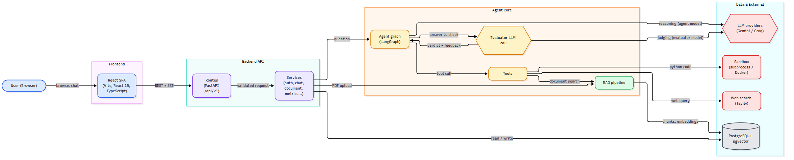
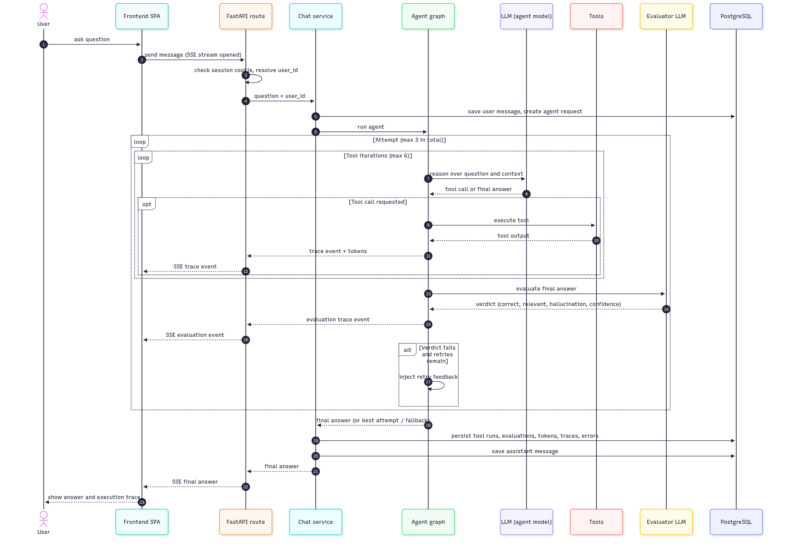
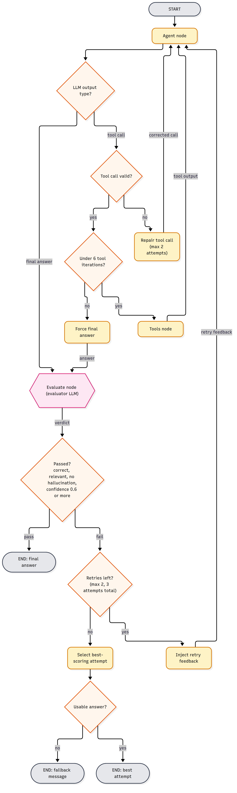
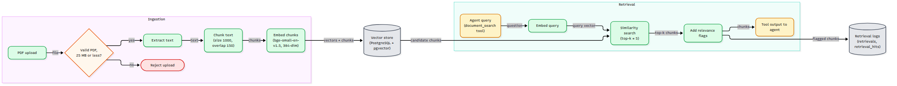
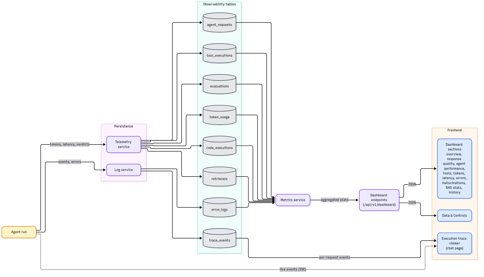
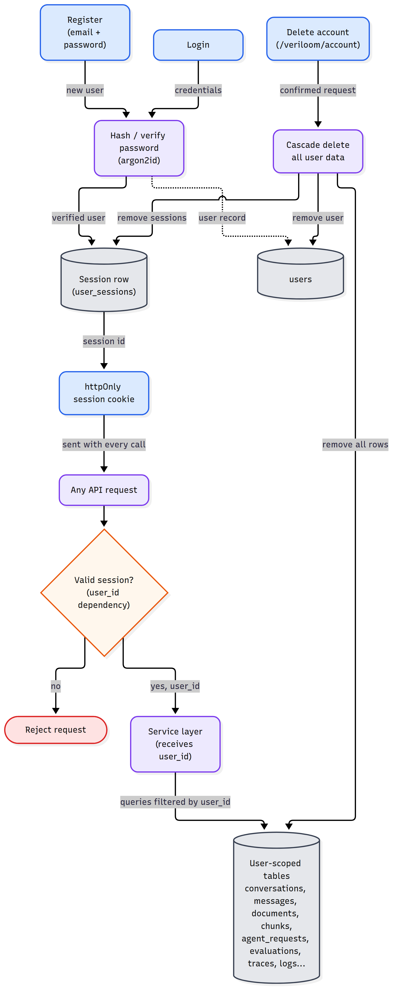

# Veriloom

### An AI agent that checks its own work, and shows you the proof.

Chat with a tool-using AI agent. Every answer is independently graded for correctness, relevance and hallucination, retried automatically if it fails, and fully traced in a live observability dashboard.

---

## Table of Contents

1. [Overview](#overview)
2. [The Problem I Solve](#the-problem-i-solve)
3. [Key Features](#key-features)
4. [Screenshots and Diagrams](#screenshots-and-diagrams)
5. [The Workflow I Used](#the-workflow-i-used)
6. [Why This Workflow Is Better and More Efficient](#why-this-workflow-is-better-and-more-efficient)
7. [Tech Stack](#tech-stack)
8. [Project Structure](#project-structure)
9. [Getting Started](#getting-started)
10. [Security and Privacy](#security-and-privacy)
11. [Author](#author)

---

## Overview

**Veriloom** is a full-stack agentic AI platform with a built-in self-evaluation loop. A user asks a question, and an agent decides which tools it needs: web search, document search over the user's own PDFs, a calculator, or a sandboxed Python executor. A second, independent AI reviewer then grades the draft answer. If the answer is wrong, unsupported or hallucinated, the agent is sent back with specific feedback and tries again before the user ever sees the result.

Everything the agent does is recorded and streamed live to the interface, so you can see which tools were called, what they returned, how the answer was graded, and how much it cost in tokens and time.

This repository contains the **frontend**: a React single page application with a chat workspace, a live execution trace viewer, and a multi-section evaluation dashboard. It talks to a FastAPI and LangGraph backend over REST and Server-Sent Events.

---

## The Problem I Solve

Large language models are fluent, but fluency is not accuracy. Teams building on top of them keep running into the same four problems:

| Problem | What it looks like in practice |
| --- | --- |
| **Hallucination** | The model states made-up facts, citations or numbers with complete confidence, and nobody notices until it matters. |
| **No visibility** | A normal chatbot is a black box. You see the answer but not the tool calls, the retrieved sources, the cost or the failures behind it. |
| **Blind trust in tools** | Search results and code output are passed along as truth without anyone checking whether they were used correctly. |
| **Evaluation is a separate chore** | Quality is usually measured later, offline, by hand or in a different system, so bad answers have already reached users. |

**Veriloom moves quality control inside the request itself.** Instead of hoping the first answer is good and measuring it afterwards, the system verifies every answer before delivering it, retries with targeted feedback when needed, and keeps a complete audit trail that feeds a dashboard of real quality metrics.

---

## Key Features

**Chat workspace**
- Streaming answers with Markdown, syntax highlighted code and LaTeX math.
- Source chips and tool chips on every message, with inline citations to web pages or document pages.
- A verification badge on each answer showing whether it passed the independent review.
- Multiple conversations with rename, search and a command palette for quick navigation.

**Live execution trace**
- Every reasoning step, tool call, tool output, evaluation and retry appears as it happens.
- Dedicated views for web search, document search, calculator and Python execution results.
- Per-request summary of elapsed time, tokens and tools used.

**Self-evaluation and self-correction**
- An independent evaluator model scores correctness, relevance, support, hallucination, logical consistency and writing quality.
- Failed answers are retried with the reviewer's specific feedback.
- Malformed tool calls are repaired automatically instead of crashing the request.
- If every attempt fails, the best scoring attempt is returned, or an honest fallback message.

**Document intelligence (RAG)**
- Upload PDFs and ask questions about them across conversations.
- Hybrid retrieval that combines semantic and keyword search, followed by a reranking step for precision.
- A chunk explorer to inspect exactly what was indexed and what was retrieved.

**Evaluation dashboard**
- Sections for overview, response quality, agent performance, tool usage, token consumption, latency, errors and hallucination statistics.
- RAG analytics and a full history of conversations, evaluations, tool executions, Python runs and self-corrections.
- A trace viewer to replay any past request.

**Accounts and privacy**
- Email and password registration with secure sessions.
- Strict per-user data isolation and one-click account deletion that removes everything.

**Polish**
- Light and dark themes, smooth motion with reduced-motion support, offline detection, lazy loaded pages, virtualized lists for large data and responsive layouts.

---

## Screenshots and Diagrams

### 1. System Architecture
The big picture: a React app talks to a FastAPI backend, which runs a LangGraph agent core that uses LLM providers, tools, a retrieval pipeline and a PostgreSQL database with vector search.

### 2. Life of a Chat Request
The full sequence from the moment a user asks a question to the moment the verified answer and its execution trace appear on screen, with every step streamed live.

### 3. Agent Self-Correction Loop
The heart of the project. The agent reasons, calls tools, drafts an answer, and an evaluator decides whether to accept it, send it back for another attempt, or fall back to the best result.

### 4. Document Retrieval Pipeline
How an uploaded PDF becomes searchable knowledge, and how the agent retrieves the most relevant passages at question time.

### 5. Observability Data Flow
How every run is captured into dedicated tables and turned into the dashboard and the live trace viewer.

### 6. Authentication and Data Isolation
How sessions are created and verified, and how every query is scoped to the signed-in user.

---

## The Workflow I Used

Veriloom is built around one idea: **an answer is not finished until it has been verified.** Each question passes through the following stages.

1. **Ask.** The user sends a message from the chat page. The browser opens a streaming connection so progress can be shown in real time.
2. **Authenticate.** The backend checks the secure session cookie and resolves the user. Everything after this point is scoped to that user.
3. **Record.** The question is saved and a new agent request is created so the whole run can be audited later.
4. **Reason and act.** The agent, built as a LangGraph state machine, reads the question, the recent conversation and an inventory of the user's documents. It decides whether it can answer directly or needs tools. It can call up to six tool rounds per attempt:
   - **Web search** for current or changing facts.
   - **Document search** for the user's uploaded PDFs.
   - **Calculator** for reliable arithmetic.
   - **Python executor** to run and test code in an isolated sandbox.
5. **Validate tool calls.** If the model produces a malformed tool call, the agent is told what was wrong and gets up to two chances to repair it.
6. **Draft the answer.** The agent writes a cited answer. If it runs out of tool rounds, it is forced to answer with what it has and to state its uncertainty.
7. **Independent evaluation.** A separate evaluator model, run with a strict and deterministic setting, reviews the question, every tool call and output, and the draft answer. It returns a structured verdict covering correctness, relevance, support, hallucination, tool interpretation, consistency, missing information, confidence and an overall quality score. It also grades each tool call individually.
8. **Decide.**
   - **Pass:** the answer is correct, relevant, free of hallucination and meets the confidence bar, so it goes to the user.
   - **Fail with retries left:** the reviewer's reasons, detected problems and suggested fix are fed back to the agent, which produces a corrected answer. Up to three attempts are made in total.
   - **Fail with no retries left:** the best scoring attempt is delivered, or a clear fallback message if nothing usable exists.
9. **Persist everything.** Tool runs, evaluations, retrievals, token usage, latency, traces and errors are saved to dedicated tables.
10. **Stream and display.** Each trace event reaches the browser the moment it happens. The user sees the final answer, the verification badge, the sources and the full execution trace.
11. **Analyse.** The dashboard aggregates all saved records into quality, performance, cost and error metrics, so the system itself can be measured and improved over time.

---

## Why This Workflow Is Better and More Efficient

### Compared with a plain chatbot

| Aspect | Typical chatbot | Veriloom |
| --- | --- | --- |
| Answer checking | None. The first draft is the final answer. | Every answer is reviewed by an independent evaluator before delivery. |
| When errors are caught | After users have already seen them, if ever. | Before delivery, with automatic retries. |
| Hallucination handling | Hope and prompt tweaks. | Explicitly detected, scored and measured. |
| Transparency | Black box. | Live trace of every step, tool call and verdict. |
| Quality measurement | Manual, offline, occasional. | Continuous, automatic and visible in a dashboard. |
| Failure behaviour | Crashes or returns confident nonsense. | Repairs bad tool calls, retries, and falls back honestly. |

### Why it is more reliable

- **A second opinion beats self-confidence.** The model that wrote an answer is the worst judge of it. A separate reviewer with strict instructions and zero randomness catches problems the author misses.
- **Feedback is specific, not generic.** A retry is not a blind re-roll. The agent receives exactly what was wrong, what is missing and how to fix it.
- **Tools are checked too.** The evaluator grades each tool call, so a bad search result or misread code output cannot slip through as fact.
- **It degrades gracefully.** Repair attempts, bounded retries and best-attempt selection mean the user always gets something honest instead of an error or a made-up answer.

### Why it is more efficient

- **Bounded effort.** Tool rounds, repair attempts and retries all have hard limits, so cost and latency cannot spiral out of control.
- **Tools only when needed.** The agent answers stable general knowledge directly and reaches for tools only when the question demands it, saving time and tokens.
- **Right model for each job.** The reasoning model and the evaluator can be different models or even different providers, so you can balance quality, speed and price independently.
- **Precise retrieval.** Hybrid search plus reranking sends only the most relevant passages to the model, which means smaller prompts, lower cost and better answers.
- **Fast to use.** Streaming shows progress immediately, pages load lazily, caching avoids repeat requests, and large lists are virtualized so the interface stays smooth with lots of data.
- **Debugging time drops sharply.** Because every run is traced and stored, finding out why an answer was wrong takes minutes instead of guesswork.

### Why it is easier to trust and maintain

- **One source of truth.** Chat, evaluation and observability share the same records, so what you see in the dashboard is exactly what happened.
- **Pluggable by design.** Tools sit behind a registry, and model providers sit behind a common interface, so adding a new tool or switching a model does not require redesigning the system.
- **Private by default.** Per-user isolation is built into every query, not bolted on afterwards.

---

## Tech Stack

### Frontend (this repository)

| Area | Technology |
| --- | --- |
| Framework | React 19 with TypeScript 5.9 |
| Build tool | Vite 7 |
| Styling | Tailwind CSS 4, class-variance-authority, tailwind-merge, clsx |
| UI primitives | Radix UI, cmdk command palette, Sonner toasts, Lucide icons |
| Routing | React Router 7 |
| Server state | TanStack Query |
| Client state | Zustand |
| Tables and lists | TanStack Table, TanStack Virtual |
| Forms and validation | React Hook Form with Zod |
| Charts | Apache ECharts and Recharts |
| Content rendering | react-markdown, remark-gfm, remark-math, rehype-katex, KaTeX, react-syntax-highlighter |
| Animation | Framer Motion |
| Networking | Axios and Server-Sent Events |
| Typography | Manrope, Syne and JetBrains Mono |
| Code quality | ESLint, Prettier |

### Backend (companion service)

| Area | Technology |
| --- | --- |
| API | FastAPI with Pydantic |
| Agent orchestration | LangGraph and LangChain |
| LLM providers | Google Gemini and Groq, selectable per role |
| Web search | Tavily |
| Database | PostgreSQL with SQLAlchemy |
| Vector search | pgvector |
| Embeddings | BGE small English model running locally via FastEmbed |
| Reranking | MS MARCO MiniLM cross-encoder |
| PDF processing | pypdf |
| Code sandbox | Isolated subprocess or Docker container |
| Authentication | Argon2 password hashing and httpOnly session cookies |

---

## Project Structure

The frontend is organised by feature, so each part of the product keeps its own components, hooks and state together.

- **app** holds the router, providers, layouts, the command palette and error handling.
- **features/chat** is the chat workspace: sidebar, composer, message list, source and tool chips, and the verification badge.
- **features/trace** powers the live execution trace, with a dedicated renderer for each tool type.
- **features/dashboard** contains every dashboard section, the chunk explorer and the history panels.
- **features/documents** handles PDF upload and the document list.
- **features/auth** and **features/account** cover registration, login and account management.
- **api** is the typed client layer, including streaming support.
- **components** is the shared design system: buttons, cards, dialogs, charts, tables, gauges and more.
- **store, hooks, lib and styles** hold global state, reusable hooks, utilities and design tokens.

---

## Getting Started

You will need Node.js 20 or newer, the Veriloom backend running locally, and API keys for the AI providers you want to use.

1. Clone this repository and install the dependencies with your preferred Node package manager.
2. Copy the example environment file to a new local environment file. The main setting is the backend API address, which defaults to the local backend on port 8000. Timeouts, retry count, dev server port and an optional query devtools switch can also be adjusted there.
3. Set up and start the backend: provide a PostgreSQL database with the vector extension, add your Gemini or Groq key plus a Tavily key for web search, then start the API server.
4. Start the frontend development server and open the local address it prints in your browser.
5. Create an account, upload a PDF if you want to try document questions, and start chatting. Open the dashboard from the top navigation to watch the metrics build up.

For a production build, use the build script from the package file, then serve the generated static output from any static host.

---

## Security and Privacy

- Passwords are hashed with Argon2 and never stored in plain text.
- Sessions use httpOnly cookies, so scripts in the browser cannot read them.
- Repeated failed logins trigger a temporary lockout.
- Every database query is filtered by the signed-in user, so one account can never see another account's chats, files or metrics.
- User code runs inside an isolated sandbox with time, memory and output limits.
- Uploads are validated and size limited.
- Users can delete their account at any time, which cascades and removes all of their data.

---

## Author

**Junaid Ul Hassan**
GitHub: [junaidulhassan](https://github.com/junaidulhassan)

If you find this project useful, consider giving it a star.
